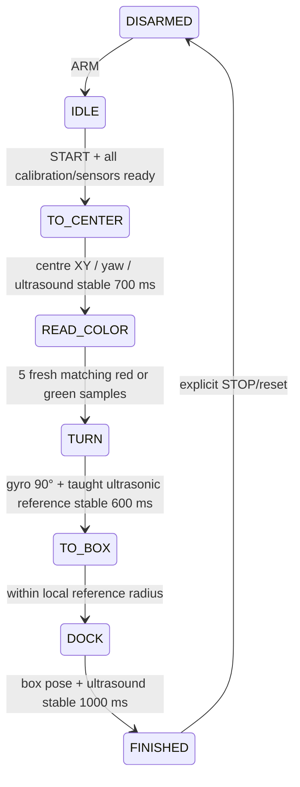

# Mega-only competition controller

The latest user-described competition sequence replaces the earlier dominant-beacon/8 cm parking routine. All sensing, localization, colour decisions, motor commands, timers and mission state run in the Arduino Mega 2560. The Mac only receives telemetry, retains recordings and sends explicit operator commands. The proposed Jetson application remains separate.

## Run and build

```bash
pio run -e mega2560
# Upload only after choosing the real board port and reviewing config.h:
pio run -e mega2560 -t upload --upload-port /dev/cu.YOUR_MEGA
./tools/start_dashboard.sh
```

Open **http://127.0.0.1:8765**. The launch script creates `.venv-dashboard`, installs pinned pyserial and runs the server. The server binds only to this Mac. Select the Mega port at **115200 baud**. Close PlatformIO's serial monitor before connecting the dashboard; two programs must not open the same serial device. USB opening may reset the Mega: connect before setting heading and arming.

The dashboard can be explored with **Try simulation → Arm → Start mission** without a board. Simulation has a prominent label, creates recordings marked `SIMULATION`, never opens a serial device, and is not a physics validation of navigation.

The default firmware builds but disables motor/sensor outputs until commissioning. `ARM` reports `MOTOR_WIRING_UNCONFIRMED`. Optional display profiles are `mega2560_oled` (SSD1306) and `mega2560_sh1106`. `mega2560_legacy` selects the older M4 pins. Do not flash sensor-enabled compile checks blindly; their pin choices have not been verified on this robot.

## Mission



Green chooses CCW/left +90° and `BOX_LEFT`. Red chooses CW/right −90° and `BOX_RIGHT`. Colour samples must be new acquisitions, not repeated loop reads. Unknown/ambiguous colour keeps the robot stopped and faults after five seconds. `FINISHED` disarms the motors and rejects re-arming until `STOP`; telemetry keeps running.

Autonomous phases stop on invalid pose/heading, loss of either ultrasonic return, insufficient measured clearance, a control-loop gap over 250 ms, a 40-second phase timeout or a 120-second mission timeout. Faults require `STOP` before re-arming. Timed manual moves and the six-pulse demo are also scheduled entirely on the Mega and terminate without a Mac heartbeat. The Mac is not an emergency-stop radio: if it is disconnected, a mission already on the Mega continues. Use a physical power stop during commissioning.

## Coordinates and the supplied geometry

The field photo `IMG_3848.JPG` supersedes the earlier collinear-light assumption. It shows a back wall, side walls, nested rectangular parking markings on either side, a small central floor marking and semicircular start markings. The middle light is on the back wall; the side lights appear mounted forward on the side walls. Perspective is not a distance measurement.

The user confirmed that **1,500 mm is the spacing between the side walls** and the side LEDs are attached directly to those walls. Model their horizontal offset from the wall surface as zero. The centre marker is reported 300 mm from the middle light. Side-light fore/aft positions, vertical offsets, side-wall lengths, start radii, box bounds and precise chassis targets are still unmeasured.

| Item | X (mm) | Y (mm) | Status |
|---|---:|---:|---|
| Middle beacon / back-wall origin | 0 | 0 | Coordinate definition |
| Left beacon | **Measure forward offset** | nominal +750 | Must explicitly enter measured XY |
| Right beacon | **Measure forward offset** | nominal −750 | Must explicitly enter measured XY |
| Centre paper marker | 300 | 0 | Supplied target; account for sensor/chassis offset |
| Left/right box poses | **Measure** | **Measure** | Capture later at the intended final chassis positions |

+X points from the back wall into the arena; +Y points left when standing at the back wall looking into the arena (+X). Left/right beacon names use that view, which is opposite a robot facing the back wall. Positive yaw is CCW: 0° faces +X, +90° faces +Y, 180° faces toward the back wall. The nominal side Y coordinates assume the middle light is on the width centreline; verify that alignment and the centre marker's perpendicular offset when surveying.

The default RAM profile records **only the middle beacon as positioned** (`beaconPositionMask=2`). Internal zeroes in the side X slots are placeholders, never confirmed locations. `BEACON` explicitly sets the measured position and optical model for that channel; all three position bits (mask 7), distinct finite coordinates and complete sensor calibration are required before localization or autonomous start can become valid. The dashboard leaves side X entries empty and plots only confirmed beacon coordinates.

The dashboard also includes the supplied photo as a local-only visual reference. It draws neither an invented wall depth/start radius nor unmeasured box bounds. The 1,500 mm field width is reported in `CALIB`; it is not used to fabricate a metric wall/ray map.

The optical detector's reference point and chassis centre are assumed coincident in XY. If they are not, compensate mounting in the sensor adapter before using taught chassis coordinates. The centre base pose must put the **underfront colour sensor over the paper**, accounting for its physical offset. Turn references use the same chassis XY; check that rotating the full footprint is collision-free.

Beyond the confirmed wall spacing, no field dimensions, metric wall map, box coordinates or encoder readings have been invented. Navigation currently follows straight waypoint segments using mecanum translation; the course must provide clear centre/box paths. Two front ±45° ultrasonics cannot cover the rear or entire body during sideways/reverse motion. The clearance threshold is a sensor-face distance, not a guaranteed chassis collision margin.

## Localization and its commissioning assumptions

`LIGHT_DRIVER=1` is an adapter for **three independent, normalized 0–1023 optical-strength measurements**, one per distinguishable beacon. This is not three arbitrary photodiodes measuring combined ambient light. The hardware's actual way of distinguishing beacons remains to be identified. If it supplies bearings, modulation IDs, a digital bus, or a different channel count, replace the adapter/model with that interface before enabling it. `LIGHT_DRIVER=0` deliberately reports invalid light data.

For the analog-strength option, each beacon has a measured ambient level, reference signal, reference slant distance, sensor-to-beacon height difference and fitted distance exponent:

```text
signal = ADC − ambient
slant_range = reference_distance × (reference_signal / signal)^(1 / exponent)
horizontal_range = sqrt(slant_range² − height_difference²)
```

The Mega fits XY to all three horizontal ranges with multiple starting estimates. It rejects dark/saturated channels, incompatible distances, excessive fit residual and competing distinct fits. It accepts general measured beacon XY coordinates, including side lights forward of the middle light. The search stays in the **+X half-plane of the back wall**, the robot's arena side. If a measured calibration happens to be collinear, this restriction also resolves a mirror ambiguity only when the mirror lies outside that half-plane; competing positive-X solutions are rejected when found. It does not assume the three lights share X=0. A low residual alone does not establish an accurate optical model.

Measure the model at several known distances **and headings** in arena lighting. The starting exponent 2 is a model hypothesis, not an established property of this sensor. Directional light response, ambient changes, saturation or indistinguishable sources can invalidate strength-to-distance ranging; if so, use a bearing/identified-beacon driver instead. Do not declare calibration valid from synthetic readings.

A gyro provides relative yaw. After every reboot/load, place the robot at a known orientation and send `HEADING degrees` while disarmed. No absolute heading is inferred from brightness. Arbitrary initial orientation requires an additional reliable heading/bearing reference; until the hardware is identified, this build requires a known starting orientation.

Near a taught centre/turn/box pose, the Mega fuses the two actual angled ultrasonic returns with optical XY and gyro yaw using a locally measured range Jacobian. This avoids assuming both angled sensors hit the same flat wall. In the photographed three-wall field, a 90° turn can change which wall each beam hits; equal left/right readings are therefore not a universal alignment rule. The model has a 120 mm / 15° validity neighborhood, rejects large innovations, and uses 40 mm optical, 2° gyro and 8 mm ultrasonic prior noise scales. Those are tuning assumptions to validate on the robot, not measured sensor specifications. Fusion affects navigation and final yaw/position checks; raw gyro progress must independently reach the commanded ±90° during the turn.

The final defaults (20 mm XY, 2° yaw, 12 mm ultrasonic agreement) are **acceptance thresholds**, not a promise of real-world precision. The local linear model, optical calibration, sensor noise and motor deadband must be measured before those thresholds are meaningful.

## Probe and measure the field

A Mega-side [guided survey routine](core_survey.md) can fit the three wall planes and estimate beacon forward offsets/brightness calibration from a stationary angular scan and known floor poses. It runs before the mission, keeps motors disarmed and reports unusable data. The local dashboard has a **Probe & measure the field** panel, raw JSON download and retained survey exports. Box outlines and exact taught poses still require operator captures.

## Capture the field references

Use the dashboard commissioning panel or commands in [serial_protocol.md](serial_protocol.md). Everything below requires `STOP` / `DISARMED`; sensor reads must be valid and gyro rate under 1.5°/s for pose captures. Allow at least 0.5 seconds after physically moving the robot so both ultrasonic median filters settle.

1. Confirm motor/shield revision and each sensor pin/model as described in [hardware.md](hardware.md). Select drivers, test raw telemetry, then confirm wiring flags. Tune wheel signs and speed output with the wheels raised first.
2. Measure both side lights' forward offsets from the back wall and all beacon XY/height coordinates first. Then calibrate all three beacon channels. Fit the exponent from at least two known slant distances after subtracting measured ambient. For signal `s1` at `d1` and `s2` at `d2`, use `n=log(s1/s2)/log(d2/d1)`. Store the model with `BEACON`. Reference signal is ambient-subtracted. Validate XY at multiple independent measured points.
3. Hold the robot at the intended centre pose with the front underside sensor over red paper. `COLOR RED`. Repeat with green paper using `COLOR GREEN`, identical sensor height and illumination. Capture reference colours only after raw channels settle.
4. At the exact centre base pose, send `TEACH CENTER 300 0 heading`. This captures the **two measured ultrasonic returns**, raw gyro and three raw beacon readings alongside the supplied measured pose.
5. From that base, manually displace **only world X** by a measured 20–80 mm (typically +50 mm), preserving heading. Send `SAMPLE CENTER X 50`. Return exactly to base.
6. Repeat for world Y, then return to base. `SAMPLE CENTER Y 50`.
7. Rotate in place by a measured 2–10° (typically +5° CCW), preserving chassis XY. `SAMPLE CENTER YAW 5`. Return to base. Negative offsets are supported if measured and signed correctly. Samples are offsets from the original base, not cumulative movements.
8. Rotate left exactly 90° at the centre. Teach `TURN_LEFT` with the same XY and centre yaw +90°, wrapped to ±180°. Repeat its X, Y and yaw offset samples. Repeat for `TURN_RIGHT` at centre yaw −90°. The turn references must agree with centre ±90° within 1°.
9. When you provide the box locations, put the chassis precisely in each box, measure its world XY and required heading, and `TEACH BOX_LEFT ...` / `TEACH BOX_RIGHT ...`. Capture the same three offset samples for each. The dashboard shows which samples are still needed.
10. `SAVE`, then `CALIB`. Saving incomplete work is allowed so commissioning can be resumed; `START` still refuses unless the profile validates. Save is explicit to avoid continual EEPROM writes. Two versioned EEPROM slots with CRC retain the last committed profile if a save loses power. The geometry-confirmation change uses EEPROM format v5; older records are deliberately not loaded and require re-entering calibration.
11. Return to the start, set its known `HEADING`, then `ARM` and `START`. Do short low-speed arena trials, compare recordings against measured position/turn errors, and tune the optical/local models and motor settings.

The dashboard never derives or substitutes navigation targets. It only forwards these capture commands, displays the Mega's replies and retains received data. Do not use a changing reflector configuration or a reference whose yaw derivative has no sensitivity; validation rejects effectively unobservable ultrasonic yaw.

## Dashboard and recordings

The dashboard displays raw gyro angle/rate, both ranges, three beacon channels, raw RGB/clear channels and detected colour, the latched colour decision, XY/yaw and localization validity, fusion residuals, motor velocity commands, target/reference, hardware mask, calibration status, mission state and faults. Upper/lower time graphs have selectable channel groups and 30 s / 2 min / loaded-history windows. Pose/range/colour invalidity creates gaps rather than plotting invalid readings as real zeroes.

Each serial connection starts a recording; pause/resume recording does not affect the Mega. SQLite at `.local-data/telemetry.sqlite3` stores samples with UTC reception time, elapsed recording time, sequence number and original Mega uptime, plus command replies/events. Replay survives server restarts. Live memory is bounded; long replay charts sample at most roughly 6,000 points and explicitly state their stride. **CSV export includes every stored sample**, not just chart points. Back up the database plus its `-wal`/`-shm` companions while running, or stop the server before copying the main file. No cloud account/service is involved.

The standalone CSV receiver remains available:

```bash
python3 -m pip install -r tools/requirements.txt
python3 tools/record_telemetry.py --port /dev/cu.YOUR_MEGA --baud 115200 --output core-run.csv
```

Do not run it alongside the dashboard on the same serial port.

## Verification and remaining hardware work

```bash
python3 tools/verify_core.py
python3 -m unittest discover -s tests -v
pio run -e mega2560 -e mega2560_legacy -e mega2560_oled -e mega2560_sh1106
```

Host C++ checks include colour filter selection, frequency gate normalization, timer/counter rollover, missing-signal and delayed-gate rejection, and complete-frame recovery. They also execute the actual controller/parser/localizer/calibration code, both red and green routes, fresh colour voting, gyro-only turn rejection, terminal finish latch, invalid sensors, watchdog timers, millis rollover, command bounds, UART ownership and interrupted EEPROM save recovery. Python checks cover wire parsing, durable recordings, complete CSV exports, simulation separation, command queuing, HTTP flow and same-origin restrictions. Browser verification uses simulation only. Builds are compilation evidence, **not a successful physical robot run**.

The colour module photo (`IMG_3849.JPG`) now shows a five-pin header with an S2/S3/OUT frequency interface consistent with TCS230/TCS3200. `COLOR_DRIVER=2` selects it; OUT must use proposed D47/T5, with S2/S3 on D44/D45. The gate for physical sensor access remains off. The driver counts pulses in hardware, and raw colour telemetry is normalized edges per 10 ms rather than Hz. See [hardware.md](hardware.md#colour-module-pictured-in-img_3849) for the full connection table.

Still awaiting hardware access: verify exact colour module/supply and hidden scaling/enable connections and beacon interface, verify MPU6050/display models and all pin connections, verify motor direction/revision, measure optical/gyro/ultrasonic calibration and loop timing on the AVR, capture actual boxes, then validate accuracy and full robot clearances in the arena. I²C probing can find responding addresses but cannot identify passive analog/frequency modules or prove their wiring.
