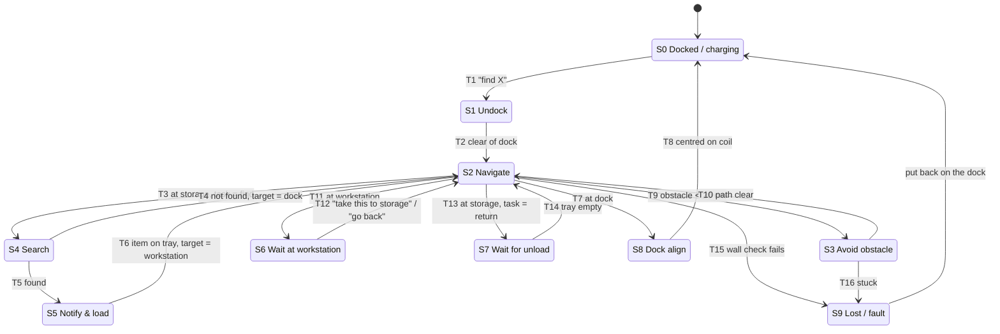

# State machine → code

This is the proposal's state diagram as implemented in [jetson/lab_assistant/state_machine.py](../jetson/lab_assistant/state_machine.py). Each transition below is marked in the code with its `# Tn` comment.

| State | Handler | Uses |
|---|---|---|
| S0 Docked | `_docked` | Resets the pose to the dock pose |
| S1 Undock | `_undock` | `navigation/move.py` |
| S2 Navigate | `_navigate` | `navigation/navigator.py` (`update`) |
| S3 Avoid obstacle | `_avoid_obstacle` | `navigation/navigator.py` (`begin_avoid`, `avoid_update`) |
| S4 Search | `_search` | `behaviors/search.py`, `perception/detector.py` |
| S5 Notify & load | `_notify_and_load` | `perception/tray.py` |
| S6 Wait at workstation | `_wait_at_workstation` | voice commands |
| S7 Wait for unload | `_wait_for_unload` | `perception/tray.py` |
| S8 Dock align | `_dock_align` | `behaviors/docking.py`, `perception/markers.py` |
| S9 Lost / fault | `_lost` | Waits for the charging voltage |

## Things the diagram leaves open, and how the code handles them

- **"go back" in the middle of a route.** The map only has routes between stations, so the robot finishes the current route and then heads to the dock. In S4 the search is cancelled: the robot strafes back to its start and then goes home. In S5, S6 and S7 it leaves for the dock straight away.
- **"stop".** Halts the robot from any state and goes to S9. Putting the robot back on the dock returns it to S0.
- **Nothing is put on the tray in S5.** After `load.timeout_s` the robot goes home.
- **Telemetry stops while the robot is moving.** It stops and goes to S9.
- **"find X" while waiting at the workstation (S6).** Starts a new search at storage.
